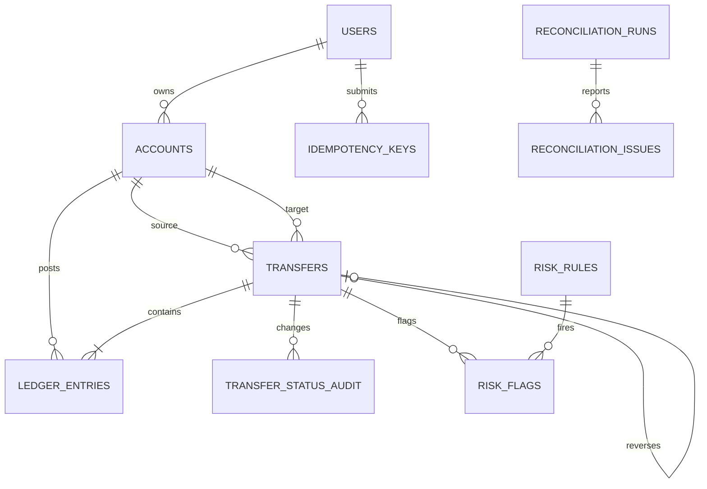

# Schema Design

## Noun List

| Noun | Stored as | Reason |
|---|---|---|
| User | `users` | Identity contact fields and KYC state are needed by wallet ownership and statement access. |
| Wallet / account | `accounts` | One table lets ledger entries point to either a user's wallet or a system account. Wallet balances are materialized for fast reads and guarded against overdrafts. |
| System account | `accounts` | Cash-in, cash-out, and fee revenue use the same accounting and ledger rules without a user owner. |
| Transfer | `transfers` | Stores the business operation, state, amount, actor accounts, and reversal link. |
| Ledger entry | `ledger_entries` | Immutable debit/credit lines are the accounting source of truth. |
| Idempotency key | `idempotency_keys` | Stores one request hash and exact first response per user/key pair. |
| Status audit | `transfer_status_audit` | Trigger-created history for every transfer status change. |
| Risk rule / flag | `risk_rules`, `risk_flags` | Thresholds and decisions are data, with one flag per fired rule/transfer. |
| Reconciliation run / issue | `reconciliation_runs`, `reconciliation_issues` | Keeps every job result and issue's expected and actual values. |
| Job lock | `job_locks` | One row coordinates concurrent reconciliation attempts. |
| Fee | Not a separate table | A fee is a transfer type and posts to the fee-revenue system account. |
| Currency | Not a separate table | INR is the only supported currency; the check constraint prevents unsupported values. |
| Statement | Not a separate table | It is a paginated query over ledger entries and transfers. |
| Fraud explanation | `risk_flags` columns | Explanation and label belong to the corresponding fired rule. |

## Cardinalities

| Relationship | Cardinality | Foreign key placement |
|---|---|---|
| User to wallet | 1:M | `accounts.owner_user_id` |
| Account to ledger entry | 1:M | `ledger_entries.account_id` |
| Transfer to ledger entry | 1:M | `ledger_entries.transfer_id` |
| Transfer to source/target account | M:1 twice | `transfers.source_account_id`, `transfers.target_account_id` |
| Transfer to reversal | 1:0..1 | `transfers.reverses_transfer_id` with a partial unique index |
| User to idempotency key | 1:M | `idempotency_keys.user_id`, unique with `key` |
| Transfer to status audit | 1:M | `transfer_status_audit.transfer_id` |
| Transfer to risk flag | 1:M | `risk_flags.transfer_id` |
| Risk rule to risk flag | 1:M | `risk_flags.risk_rule_id` |
| Reconciliation run to issue | 1:M | `reconciliation_issues.reconciliation_run_id` |

## ER Diagram

## Money and Constraints

All amounts are positive `BIGINT` paise. Direction is a separate `DEBIT`/`CREDIT` field, so aggregation never relies on floating-point values. Transfers in `POSTED` state must have at least two balanced ledger lines at commit; a deferred constraint trigger permits the transfer and its entries to be inserted in one SQL transaction. A trigger rejects ledger updates and deletes. `accounts.balance_paise` is materialized: a conditional lock-protected transfer updates it atomically with the immutable entries. The database check on user-owned account balances prevents negative values; system accounts are allowed to go negative.

Email and phone are externally supplied contact data. They have uniqueness constraints because the current product assumes one account per contact value, but they can change and are not identifiers, so generated `user_id` remains the primary key.

`READ COMMITTED` plus `SELECT ... FOR UPDATE` is used for money writes. Both account rows are locked in ascending ID order, then the source balance is re-read while locked. The per-wallet lock serializes competing spends, while the ordering avoids transfer deadlocks. `SERIALIZABLE` would add retries and reduce throughput without strengthening this single-row balance invariant beyond the explicit row lock and constraint.

## Indexes

The statement index is `(account_id, created_at DESC, ledger_entry_id DESC)`. Transfer history has source and target indexes ordered by creation time. The unique `(user_id, key)` constraint supports idempotency lookup. Foreign keys and reconciliation support indexes are present for transfer and account joins. Each extra index adds write and storage cost; these cover the hot read paths and foreign-key checks in this assignment.